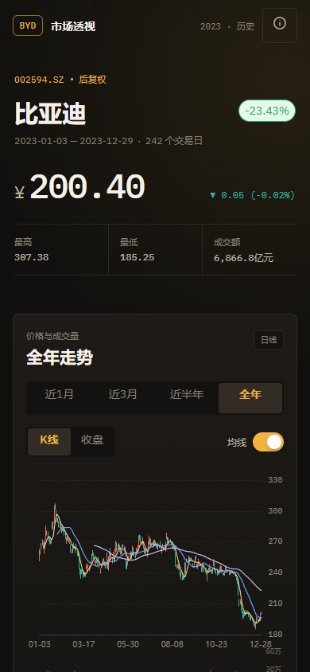

# 比亚迪 2023 行情透视

一个移动端优先的静态 H5 页面，用比亚迪后复权日线数据回看 2023 年价格走势、
成交量、回撤、波动率和月度表现。



## 仓库位置

本作业位于个人仓库的独立目录：

https://github.com/huashengmi32-a11y/sina-dividend-lab-v2/tree/main/byd-market-lens

## 在线 H5

https://huashengmi32-a11y.github.io/sina-dividend-lab-v2/byd-market-lens/

## 交付内容

- 可静态托管的 H5：`docs/index.html`
- 页面源代码：`src/`
- 数据清洗与分析：`scripts/prepare_data.py`
- 移动端和桌面端截图：`screenshots/`
- TDesign MCP 调用记录：`deliverables/tdesign-mcp-usage.md`
- 数据结论与口径：`deliverables/data-analysis.md`
- 脱敏交互记录：`deliverables/agent-conversation.md`
- 浏览器验收结果：`deliverables/browser-verification.json`
- 线上页面验收结果：`deliverables/live-page-verification.json`
- 项目约束：`AGENTS.md`
- UI/UX 设计系统：`design-system/byd-market-lens/MASTER.md`

## 核心结论

- 数据覆盖 2023-01-03 至 2023-12-29，共 242 个交易日。
- 期末收盘价 200.40，按首尾收盘价计算全年回报 -23.43%。
- 盘中最高价 307.38，盘中最低价 185.25。
- 收盘价口径最大回撤 -38.71%，从 2023-02-01 持续至 2023-12-20。
- 年化波动率 26.97%，上涨交易日 102 天，下跌交易日 140 天。
- 12 个月中 4 个月上涨、8 个月下跌；11 月跌幅最大，为 -16.35%。

完整指标与计算口径见 `deliverables/data-analysis.md`。

## 页面能力

- K 线与收盘价双视图，可用 TDesign Segmented 切换。
- 近 1 月、近 3 月、近半年和全年范围切换。
- MA5、MA20、MA60 均线开关。
- 价格图与成交量共享时间轴，支持拖动缩放和触屏查看。
- 最大回撤、波动率、涨跌天数、平均换手率概览。
- 月度收益条形图、关键历史节点和最近交易日明细。
- 完整 242 日数据表作为图表的文字回退。
- 数据口径弹窗，明确这是历史分析而非实时行情或投资建议。

## 技术选型

- Vue 3 + Vite 8：静态 H5 构建和组件状态管理。
- TDesign Mobile Vue 1.16：分段选择、开关、标签、弹窗、按钮和单元格。
- ECharts 6：K 线、收盘线、成交量和交互式提示。
- 本地 IBM Plex 字体：避免页面运行时依赖远程字体服务。
- Playwright + 本机 Chrome：移动端截图、响应式与运行错误检查。

## TDesign MCP

Codex 全局 MCP 配置已加入：

```toml
[mcp_servers.tdesign]
command = "npx"
args = ["-y", "tdesign-mcp-server"]
```

仓库内的验证脚本会直接通过 MCP 协议连接
`tdesign-mcp-server@0.2.4`，读取 `mobile-vue` 组件列表、文档和 DOM：

```powershell
npm run verify:mcp
```

本次查询了 `Button`、`Segmented`、`Switch`、`Tag`、`Dialog`、`Cell`，并搜索
了图表相关图标。原始返回结果保存在 `deliverables/tdesign-mcp-report.json`。

## 本地运行

```powershell
npm ci
npm run data
npm run build
npm run preview -- --port 4173
```

访问 `http://127.0.0.1:4173/`。

## 验证命令

```powershell
npm run verify:mcp
npm run screenshot
```

截图脚本默认启动本机 Chrome，检查 390 x 844 移动端和 1280 x 900 桌面端，
并验证 320、375、768、1024、1440 px 宽度无横向滚动。

## 发布到 GitHub Pages

构建产物已经提交在 `docs/`。在仓库设置中选择：

- Source: `Deploy from a branch`
- Branch: `main`
- Folder: `/docs`

## Agent 信息

- AI Agent 软件：OpenAI Codex Desktop
- 本次会话模型配置：`deepseek-flash`

## 说明

所有价格均为数据源提供的后复权历史价格。页面只描述 2023 年的历史表现，不预测
未来价格，不构成任何投资建议。

